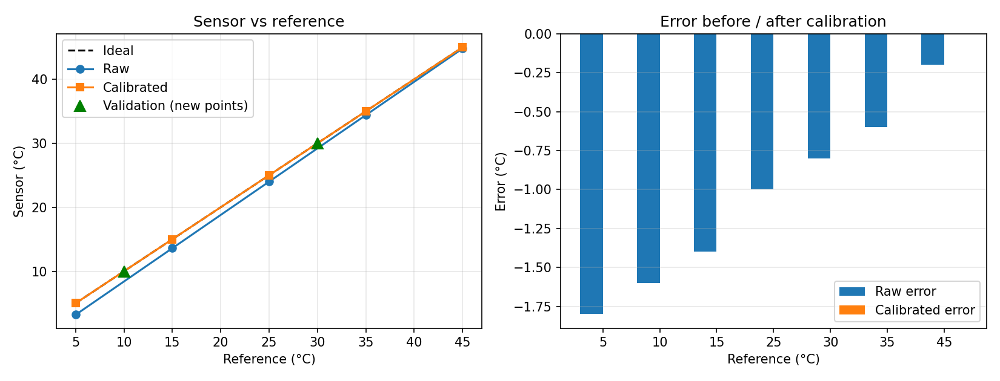

# Project 1: Temperature & Humidity Telemetry Station

**Objective:** read a digital sensor, calibrate it against a reference thermometer, and stream
JSON securely to AWS IoT Core every 5 s.

## Important: this is a simulation
Built in the Wokwi simulator, not on physical hardware.
- **DHT22** = sensor under test, with a *deliberately injected* error:
  `T_raw = 1.04 * T_true - 2.0 degC`, `RH_raw = RH_true + 3.0 %RH`.
- **DS18B20** = stand-in "reference thermometer" (the simulator has no real lab instrument).
- Humidity reference is the simulator's true value (there is no second humidity sensor).

Because the injected error is perfectly linear, the calibrated error comes out at 0.00.
On real hardware, expect small residual errors from noise, resolution and non-linearity.

## Architecture
```
Wokwi ESP32 --TLS (8883) / MQTT--> AWS IoT Core --> MQTT test client
  |- DHT22   (sensor under test)
  '- DS18B20 (reference)
```
- Topic: `dt/lab1/p1-esp32-sim-01/telemetry`
- Auth: X.509 device certificate, least-privilege IoT policy (Connect + Publish on own topic only, see `aws/policy.json`)
- Payload fields: `device_id`, `ts` (Unix s), `temp_raw_c`, `temp_cal_c`, `temp_ref_c`, `hum_raw_pct`, `hum_cal_pct`, `hum_ref_pct`, units

## Method
1. Set DHT22 and DS18B20 to the same temperature at 5, 15, 25, 35, 45 degC; record raw vs reference.
2. Least-squares fit `ref = gain * raw + offset` (`analysis/calibrate.py`).
3. Put constants into firmware: `gain = 0.96154`, `offset = +1.9231 degC`, humidity offset `-3.0 %RH`.
4. Validate on two new points not used in the fit (10 and 30 degC).

## Results
| Ref (degC) | Raw | Calibrated | Raw error | Cal error | In fit? |
|---|---|---|---|---|---|
| 5 | 3.20 | 5.00 | -1.80 | 0.00 | yes |
| 15 | 13.60 | 15.00 | -1.40 | 0.00 | yes |
| 25 | 24.00 | 25.00 | -1.00 | 0.00 | yes |
| 35 | 34.40 | 35.00 | -0.60 | 0.00 | yes |
| 45 | 44.80 | 45.00 | -0.20 | 0.00 | yes |
| 10 | 8.40 | 10.00 | -1.60 | 0.00 | **no (validation)** |
| 30 | 29.20 | 30.00 | -0.80 | 0.00 | **no (validation)** |

- Before: RMSE **1.15 degC**, max error **1.80 degC** (4.5 % of the 40 degC span)
- After: RMSE **0.00 degC**, max error **0.00 degC**
- Humidity: 43.0 -> 40.0 %RH



## Resolution, accuracy and error sources
- Resolution: DHT22 0.1 degC / 0.1 %RH; DS18B20 0.0625 degC (12-bit)
- Datasheet accuracy (verify against datasheets): DHT22 about +/-0.5 degC; DS18B20 about +/-0.5 degC
- Error sources: sensor gain/offset (injected here), quantisation, reference accuracy,
  self-heating and response time (real hardware only)
- Limitation: a linear fit cannot correct non-linearity; a 2nd-order fit would be the next step

## Reliability note
Occasional `rc=-2` connection drops and `publish failed` lines were seen in the simulator;
the firmware reconnects automatically, so a few messages are lost.

## Lessons
- TLS needs correct time: the clock must be synced over NTP before connecting.
- Validate on points that were not used for fitting.
- The IoT policy resource ARNs must match the client ID and topic exactly.

## Run it yourself
1. Create an IoT Thing + certificate, attach a policy like `aws/policy.json`.
2. Copy `firmware/secrets.example.h` to `secrets.h` and fill in your endpoint and certificates.
3. Paste the firmware into a Wokwi ESP32 (Arduino) project with `diagram.json` and `libraries.txt`.
4. Subscribe to `dt/lab1/+/telemetry` in the MQTT test client.

## Cleanup
Detach and delete the certificate, delete the policy and the Thing when finished.
